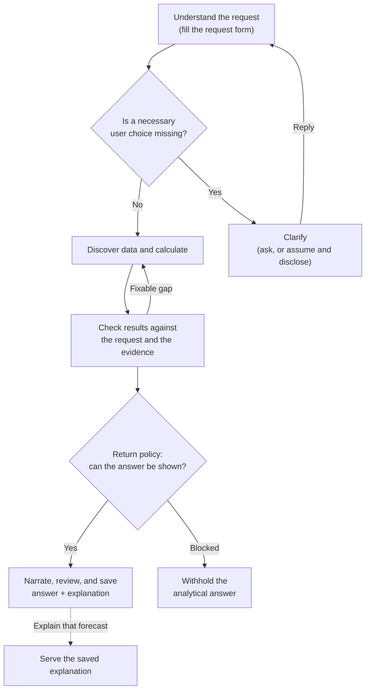
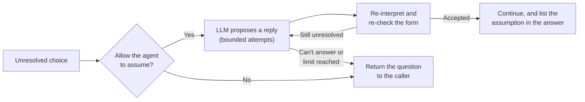
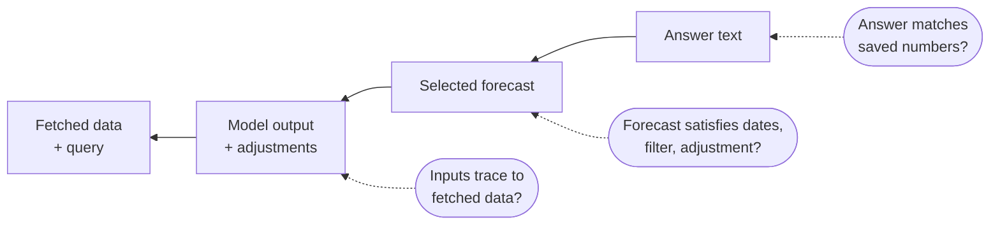
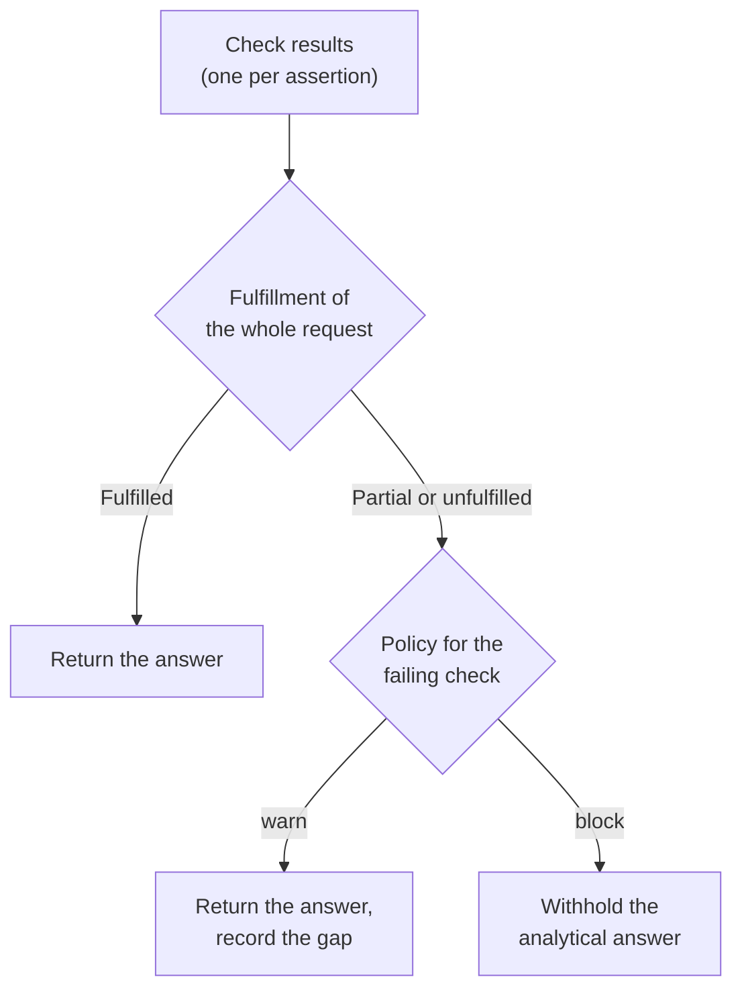
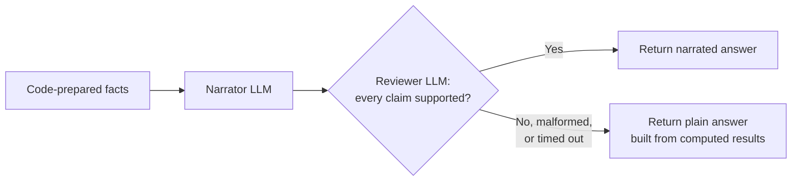

LLM agents are very good at producing answers that look right. Ask a forecasting agent, "Forecast next week's sales for our Downtown store. It will be closed Monday," and it will return a tidy table of seven numbers and a confident paragraph. The table might also use another store's data, predict normal sales on Monday, or describe a calculation that never ran. Nothing about the answer's appearance tells you which.

I have been thinking a lot about this problem. For an analytical agent, the hard part is often not making the forecast more accurate. It is making sure the answer actually follows the request, and being able to show that it does.

The framework I keep coming back to is a financial audit. A company does its accounting and keeps receipts. An auditor checks whether the receipts support the books, then issues an opinion: clean, qualified, or unable to give one. The auditor does not redo the company's work, and a clean opinion does not mean the business strategy was good. It only means the numbers are supported by records. An agent can be held to the same standard.

| Audit | Agent |
| --- | --- |
| The engagement letter: what the client asked for | The request form: what the user asked for |
| Receipts and ledgers | Evidence: data fetched, queries run, model outputs |
| The auditor's tests | Checks that compare evidence with the request |
| Clean or qualified opinion | Fulfilled or partial |
| "Unable to express an opinion" | Insufficient evidence |

Put together, the flow looks like this:

## Write Down What Was Asked

The first step turns the user's words into a request form. An LLM proposes the values; code validates them, merges them with earlier turns, and applies defaults. Each field records where its value came from:

| User's words | Field | Source |
| --- | --- | --- |
| "sales" | metric = sales | User stated |
| "Downtown store" | store = Downtown | User stated |
| November 16–22 | period | User stated |
| "daily" | grain = day | LLM interpreted |
| "closed Monday" | adjustment = zero on Mondays | LLM inferred |
| *(nothing said)* | data source = empty | Execution will discover it |

Two distinctions matter. First, "Downtown store" records what the user selected, not a database mapping. The form does not claim a `Store` column exists; execution still has to find the data and apply the filter. Second, "resolved" means the agent understood the instruction, not that it was carried out. "Closed Monday means zero sales" is an inference, and if the store also sells online, it may be the wrong one. The form makes that assumption visible instead of baking it silently into the numbers.

The form also gives the agent memory. If the user says, "Forecast daily sales with 95% intervals," and then, "Change the intervals to 90%," only the interval changes. The dates, grain, and metric carry over, labeled as coming from the previous turn rather than pretending the user said them again.

The failures I worry about most are rarely bad math. They are quiet substitutions: a store filter dropped between turns, a weekly grain where the user asked for daily. Each produces plausible numbers. Writing the request down gives every later step something concrete to check against.

## Ask Only When You Must

A good analyst does not ask a stakeholder questions the data can answer. "Forecast 14 days after the last observation" needs no clarification; code can read the data and calculate the dates. Several candidate tables also do not require a question. The agent can pick a suitable source and record which one it used.

I prefer that code, not an LLM, decides what is missing. The developer marks required fields, like what to forecast and over which period, as unresolved by default. After interpretation and defaults, code looks for anything still unresolved. An optional field left empty, like grain, is not a reason to interrupt the user. This is deterministic and testable: the same request always produces the same question. The limit is that code can only find fields that are still empty. It cannot detect a field the LLM filled in with the wrong meaning.

There is a wrinkle when one agent calls another. Once a sub-agent returns a question upstream, the answer may never come back. One option is to let a separate LLM call answer the clarification on the user's behalf:

The guardrails are what make this acceptable. Every proposed reply goes back through the same interpretation and checks, and it cannot overwrite anything the user already stated. If the user said Downtown, the agent cannot switch to a store with more data just to get unstuck. Every accepted assumption is shown to the user and never presented as something they said.

I do not necessarily believe every agent should answer its own questions. For a single-user chat assistant, asking is usually better. In a multi-agent system, an unanswered question can be worse than a disclosed, reasonable assumption. The deciding factor is whether a human will reliably see the question.

## Keep the Receipts

Evidence is a record of the work. Each answer links back through a chain of saved records, and each check tests one link in that chain:

Each record should carry an ID for the request and the attempt, plus a fingerprint of its contents. Agents retry. Without those IDs, a check can pass by comparing the answer against records from an earlier, discarded attempt.

Evidence is not proof by itself. For the store closure, the evidence shows Monday's final prediction is 100; the check compares it to the zero-sales rule; the finding is a mismatch. If the records needed to make that comparison are missing, the finding should be **insufficient evidence**, not "pass."

That state is, in my opinion, the most important design choice. An auditor who cannot find a receipt does not assume the expense was fine. In an agent, a missing record usually means a step was skipped or failed quietly, which is exactly the case you most want to surface.

## Pass, Fail, and "We Couldn't Tell"

Three ideas are easy to blur together:

1. **A check result** describes one assertion: pass, fail, insufficient evidence, or not evaluated.
2. **Fulfillment** describes the whole request: fulfilled, partial, or unfulfilled.
3. **A return policy** decides whether the answer can be shown. Each check is set to warn or block by the agent's developer, never by the user's prompt.

Consider: "Forecast next week's Downtown sales, make Monday zero, compare two models, and explain your assumptions." Suppose the forecast and Monday adjustment are verified, but there is no evidence of a model comparison. Fulfillment is partial. With warn, the answer is returned and the gap is recorded; with block, the analytical answer is withheld. Neither setting turns the missing comparison into completed work. This is the audit's qualified opinion: mostly supported, with a named exception.

It also helps to separate a verification gap from a confirmed problem. "We cannot establish the filter scope" can live in the saved explanation, available on request. "The requested adjustment was not applied" belongs in the main answer, with the values labeled as unadjusted estimates. If every answer opens with routine caveats about checking, users learn to skip them, and then they skip the one warning that matters.

## Let the Words Follow the Numbers

The final answer can be written in two LLM calls. Code prepares the facts; a narrator writes the answer; a reviewer checks whether every claim is supported.

The reviewer exists because narrators like to tell stories. If sales are forecast to grow, the narrator may write that "the spring campaign drove growth." Nothing in the data establishes a cause. The reviewer should also see facts the narrator does not, such as how much history was actually used. "Use the last twelve months" is a requirement, not evidence that twelve months were used.

The tradeoff is latency and cost: two extra LLM calls on every answer. Keeping it to a single narrate-and-review pass under a fixed time budget, with a plain fallback, bounds both. The fallback changes only the wording; it should never upgrade a partial answer to a fulfilled one.

## Explain From the Saved Work

When the user asks, "Explain that forecast," the agent should return the explanation saved with the original answer: the data, calculation, assumptions, and remaining uncertainty. It should not rerun the forecast. Rerunning explains a new calculation, which can differ from the one the user is looking at. If the saved records are missing or have changed, the honest answer is that the explanation cannot be verified.

This is the same principle as tracking predictions in my [earlier post](/blogs/making-better-predictions/). You cannot learn from a prediction you didn't write down, and you cannot explain an answer whose work you didn't save.

## What This Doesn't Solve

It is tempting to read "all checks passed" as "the answer is correct." Three gaps remain:

- **Omitted instructions.** If the LLM drops a command during interpretation, the checks have nothing to compare against. A request form only protects what made it onto the form.
- **Accuracy.** Faithful calculations do not guarantee good predictions. That is what backtesting and benchmarks are for.
- **Wrong framing.** Imagine a user asks, "Why is this month's forecast higher than last month's?" with no earlier forecast in the conversation. They want an existing forecast explained. An agent built around a forecasting form may treat it as a request for a new forecast and ask which period to forecast. The clarification logic works as designed; it just answers the wrong question. This is the same "resolved but wrong meaning" limit from earlier, and checks downstream cannot catch it.

If I were starting a new agent tomorrow, I would build two things before anything else: the request form with a source on every field, and the insufficient-evidence state. Both are cheap. The form makes every later check possible, and the insufficient-evidence state keeps a missing check from being reported as a passed one. The rest of the design follows from those two.
